# Campus Verse - System Flowcharts

## Table of Contents

1. [High-Level System Architecture](#1-high-level-system-architecture)
2. [User Authentication Flow](#2-user-authentication-flow)
3. [Organization Setup Flow](#3-organization-setup-flow)
4. [Student Lifecycle Flow](#4-student-lifecycle-flow)
5. [Admissions Pipeline Flow](#5-admissions-pipeline-flow)
6. [Finance Module Flow](#6-finance-module-flow)
7. [Fee Collection Flow](#7-fee-collection-flow)
8. [Attendance Flow](#8-attendance-flow)
9. [HR & Leave Management Flow](#9-hr--leave-management-flow)
10. [Academics & Timetable Flow](#10-academics--timetable-flow)
11. [Exams & Gradebook Flow](#11-exams--gradebook-flow)
12. [Communications Flow](#12-communications-flow)
13. [Complete Data Flow Diagram](#13-complete-data-flow-diagram)
14. [Module Interaction Map](#14-module-interaction-map)

---

## 1. High-Level System Architecture

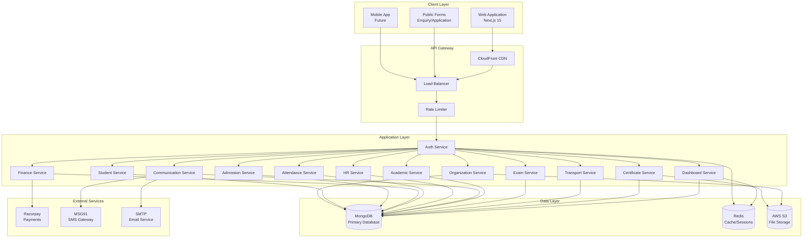

---

## 2. User Authentication Flow

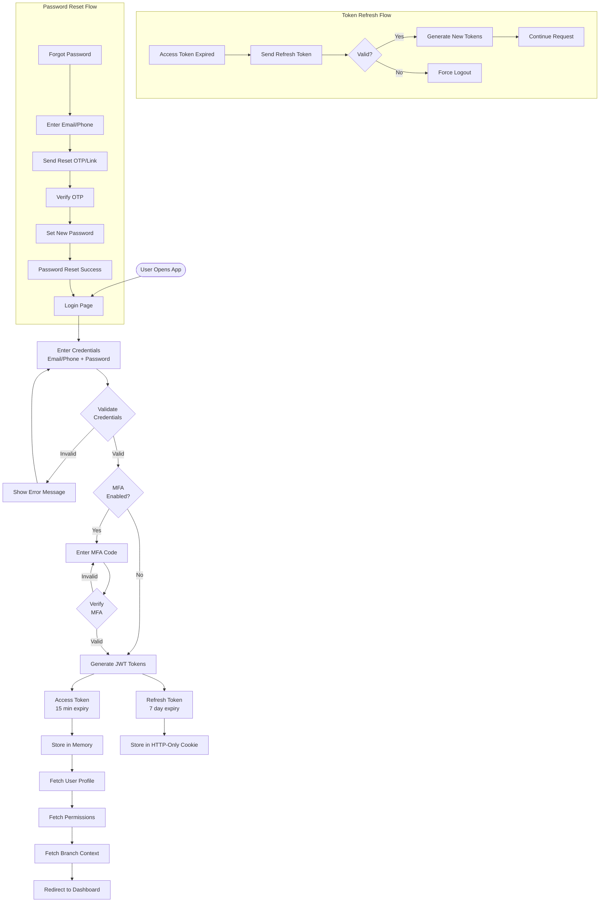

---

## 3. Organization Setup Flow

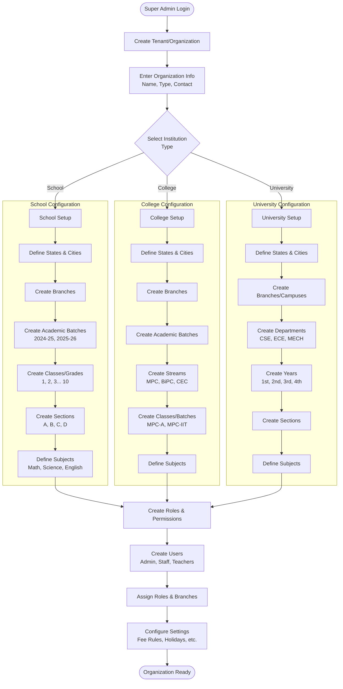

---

## 4. Student Lifecycle Flow

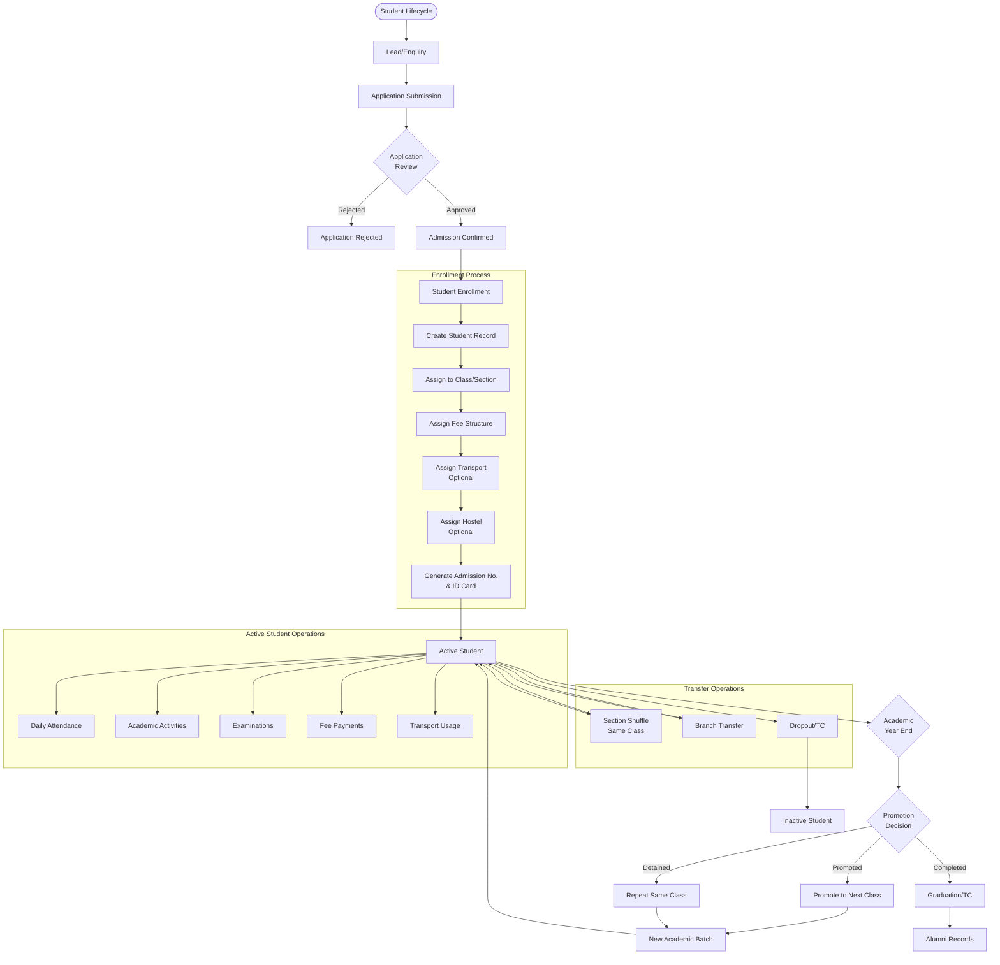

---

## 5. Admissions Pipeline Flow

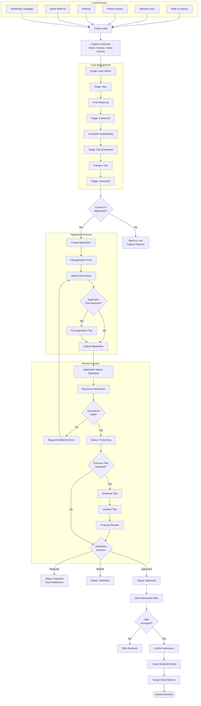

---

## 6. Finance Module Flow

```mermaid
flowchart TD
    subgraph Fee_Setup["Fee Structure Setup"]
        START([Finance Setup]) --> FEE_TYPE[Define Fee Types<br/>Tuition, Transport, Hostel, Exam]
        FEE_TYPE --> FEE_STRUCTURE[Create Fee Structure]
        FEE_STRUCTURE --> ADD_COMPONENTS[Add Fee Components<br/>Amount per Type]
        ADD_COMPONENTS --> INSTALLMENTS[Define Installments<br/>Term 1, Term 2, Term 3]
        INSTALLMENTS --> DUE_DATES[Set Due Dates]
        DUE_DATES --> FINE_RULES[Configure Fine Rules<br/>Late Fee Calculation]
    end

    subgraph Fee_Assignment["Fee Assignment"]
        FINE_RULES --> ASSIGN_TYPE{Assignment<br/>Type}
        ASSIGN_TYPE -->|Individual| SINGLE[Select Student]
        ASSIGN_TYPE -->|Bulk| BULK[Select Class/Section]
        SINGLE --> MAP_FEE[Map Fee Structure]
        BULK --> MAP_FEE
        MAP_FEE --> CALCULATE[Calculate Total Fees]
        CALCULATE --> CREATE_DUES[Create Due Records]
    end

    subgraph Concessions["Concession Management"]
        CREATE_DUES --> CONCESSION{Concession<br/>Applicable?}
        CONCESSION -->|Yes| REQUEST_CON[Request Concession]
        REQUEST_CON --> CON_TYPE[Select Concession Type<br/>Scholarship, Sibling, Staff Ward]
        CON_TYPE --> CON_AMOUNT[Enter Amount/Percentage]
        CON_AMOUNT --> CON_APPROVE{Approval<br/>Required?}
        CON_APPROVE -->|Yes| SUBMIT_CON[Submit for Approval]
        SUBMIT_CON --> REVIEW_CON{Review<br/>Decision}
        REVIEW_CON -->|Rejected| CON_REJECTED[Concession Rejected]
        REVIEW_CON -->|Approved| APPLY_CON[Apply Concession]
        CON_APPROVE -->|No| APPLY_CON
        APPLY_CON --> ADJUST_DUES[Adjust Due Amount]
        CONCESSION -->|No| FINAL_DUES
        ADJUST_DUES --> FINAL_DUES[Final Due Amount]
    end

    subgraph Fee_Collection["Fee Collection"]
        FINAL_DUES --> COLLECT[Fee Counter]
        COLLECT --> SELECT_STUDENT[Search/Select Student]
        SELECT_STUDENT --> VIEW_DUES[View Outstanding Dues]
        VIEW_DUES --> SELECT_ITEMS[Select Items to Pay]
        SELECT_ITEMS --> PAYMENT_MODE{Payment<br/>Mode}
        PAYMENT_MODE -->|Cash| CASH[Record Cash Payment]
        PAYMENT_MODE -->|Card| CARD[Card Payment]
        PAYMENT_MODE -->|Online| ONLINE[Razorpay Gateway]
        PAYMENT_MODE -->|Cheque| CHEQUE[Record Cheque Details]
        CASH --> RECORD
        CARD --> RECORD
        ONLINE --> GATEWAY[Process Payment]
        GATEWAY -->|Success| RECORD
        GATEWAY -->|Failed| RETRY[Retry Payment]
        RETRY --> PAYMENT_MODE
        CHEQUE --> RECORD[Record Transaction]
    end

    subgraph Receipt_Generation["Receipt Generation"]
        RECORD --> GEN_RECEIPT[Generate Receipt Number]
        GEN_RECEIPT --> CREATE_PDF[Create PDF Receipt]
        CREATE_PDF --> SEND_RECEIPT{Send<br/>Receipt?}
        SEND_RECEIPT -->|SMS| SEND_SMS[Send SMS]
        SEND_RECEIPT -->|Email| SEND_EMAIL[Send Email]
        SEND_RECEIPT -->|Print| PRINT[Print Receipt]
        SEND_SMS --> COMPLETE
        SEND_EMAIL --> COMPLETE
        PRINT --> COMPLETE([Payment Complete])
    end
```

---

## 7. Fee Collection Flow

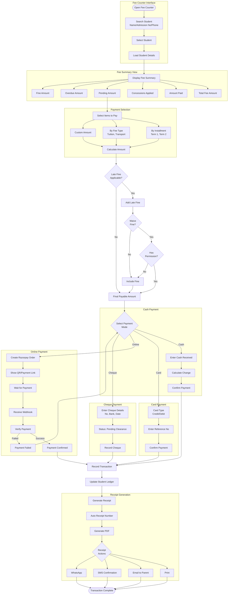

---

## 8. Attendance Flow

```mermaid
flowchart TD
    subgraph Student_Attendance["Student Attendance Flow"]
        START([Start Attendance]) --> SELECT_DATE[Select Date]
        SELECT_DATE --> SELECT_CLASS[Select Class/Section]
        SELECT_CLASS --> LOAD_STUDENTS[Load Student List]

        LOAD_STUDENTS --> CHECK_HOLIDAY{Is Holiday?}
        CHECK_HOLIDAY -->|Yes| HOLIDAY_MSG[Cannot Mark<br/>Holiday]
        CHECK_HOLIDAY -->|No| EXISTING{Existing<br/>Record?}

        EXISTING -->|Yes| LOAD_EXISTING[Load Existing Attendance]
        EXISTING -->|No| NEW_RECORD[Create New Record]

        LOAD_EXISTING --> MARK
        NEW_RECORD --> MARK[Mark Attendance]

        subgraph Marking["Attendance Marking"]
            MARK --> FOREACH[For Each Student]
            FOREACH --> STATUS{Select<br/>Status}
            STATUS -->|Present| PRESENT[Mark Present]
            STATUS -->|Absent| ABSENT[Mark Absent]
            STATUS -->|Late| LATE[Mark Late<br/>Enter Time]
            STATUS -->|Leave| LEAVE[Mark on Leave]
            PRESENT --> NEXT
            ABSENT --> NEXT
            LATE --> NEXT
            LEAVE --> NEXT
            NEXT --> MORE{More<br/>Students?}
            MORE -->|Yes| FOREACH
            MORE -->|No| REVIEW
        end

        REVIEW[Review Attendance] --> SUBMIT[Submit Attendance]
        SUBMIT --> SAVE[Save to Database]
        SAVE --> NOTIFY{Send<br/>Notifications?}
        NOTIFY -->|Yes| ABSENT_SMS[SMS for Absentees]
        NOTIFY -->|No| COMPLETE
        ABSENT_SMS --> COMPLETE([Attendance Complete])
    end

    subgraph Staff_Attendance["Staff Attendance Flow"]
        STAFF_START([Staff Attendance]) --> STAFF_DATE[Select Date]
        STAFF_DATE --> STAFF_DEPT[Select Department<br/>Optional]
        STAFF_DEPT --> LOAD_STAFF[Load Staff List]

        LOAD_STAFF --> STAFF_CHECK{On Leave?}
        STAFF_CHECK -->|Yes| AUTO_LEAVE[Auto-mark Leave]
        STAFF_CHECK -->|No| STAFF_MARK[Mark Attendance]

        STAFF_MARK --> CHECKIN[Check-in Time]
        CHECKIN --> CHECKOUT[Check-out Time]
        CHECKOUT --> CALC_HOURS[Calculate Hours]
        CALC_HOURS --> LATE_CHECK{Late<br/>Arrival?}
        LATE_CHECK -->|Yes| MARK_LATE[Mark as Late]
        LATE_CHECK -->|No| STAFF_SAVE
        MARK_LATE --> STAFF_SAVE[Save Record]
        AUTO_LEAVE --> STAFF_SAVE
        STAFF_SAVE --> STAFF_DONE([Staff Attendance Done])
    end

    subgraph Reports["Attendance Reports"]
        REPORT_START([Generate Report]) --> REPORT_TYPE{Report<br/>Type}
        REPORT_TYPE -->|Daily| DAILY[Daily Summary<br/>Class-wise Present/Absent]
        REPORT_TYPE -->|Monthly| MONTHLY[Monthly Summary<br/>Student-wise %]
        REPORT_TYPE -->|Student| STUDENT[Student History<br/>Date-wise Record]
        REPORT_TYPE -->|Class| CLASS[Class Report<br/>Attendance Trends]

        DAILY --> EXPORT
        MONTHLY --> EXPORT
        STUDENT --> EXPORT
        CLASS --> EXPORT
        EXPORT[Export PDF/Excel] --> REPORT_DONE([Report Generated])
    end
```

---

## 9. HR & Leave Management Flow

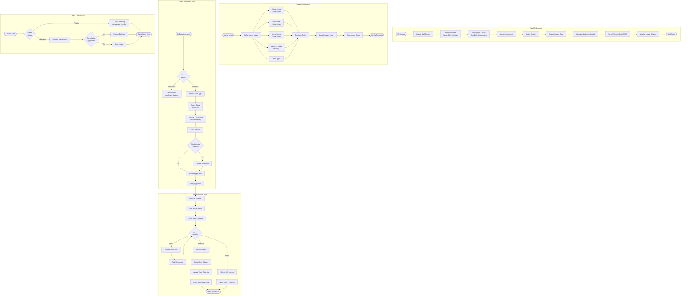

---

## 10. Academics & Timetable Flow

```mermaid
flowchart TD
    subgraph Teacher_Allocation["Teacher-Subject Allocation"]
        START([Academics Setup]) --> SELECT_BATCH[Select Academic Batch]
        SELECT_BATCH --> SELECT_CLASS[Select Class/Section]
        SELECT_CLASS --> LIST_SUBJECTS[List Subjects]

        LIST_SUBJECTS --> FOREACH_SUBJECT[For Each Subject]
        FOREACH_SUBJECT --> ASSIGN_TEACHER[Assign Teacher]
        ASSIGN_TEACHER --> CHECK_WORKLOAD{Exceeds<br/>Workload?}
        CHECK_WORKLOAD -->|Yes| WARNING[Show Warning]
        WARNING --> CONFIRM{Confirm<br/>Anyway?}
        CONFIRM -->|No| ASSIGN_TEACHER
        CONFIRM -->|Yes| SAVE_ALLOC
        CHECK_WORKLOAD -->|No| SAVE_ALLOC[Save Allocation]
        SAVE_ALLOC --> MORE_SUBJECTS{More<br/>Subjects?}
        MORE_SUBJECTS -->|Yes| FOREACH_SUBJECT
        MORE_SUBJECTS -->|No| ALLOC_DONE([Allocation Complete])
    end

    subgraph Timetable_Creation["Timetable Creation"]
        TT_START([Create Timetable]) --> TT_CLASS[Select Class/Section]
        TT_CLASS --> TT_VIEW[Open Timetable Grid<br/>Days x Periods]

        TT_VIEW --> TT_SLOT[Select Time Slot]
        TT_SLOT --> TT_SUBJECT[Select Subject]
        TT_SUBJECT --> TT_TEACHER[Auto-fill Teacher<br/>from Allocation]
        TT_TEACHER --> TT_ROOM{Assign<br/>Room?}
        TT_ROOM -->|Yes| SELECT_ROOM[Select Room]
        TT_ROOM -->|No| CHECK_CONFLICT
        SELECT_ROOM --> CHECK_CONFLICT{Check<br/>Conflicts}

        CHECK_CONFLICT -->|Teacher Busy| CONFLICT_T[Teacher Conflict]
        CHECK_CONFLICT -->|Room Busy| CONFLICT_R[Room Conflict]
        CHECK_CONFLICT -->|No Conflict| SAVE_SLOT[Save Slot]

        CONFLICT_T --> RESOLVE[Resolve Conflict]
        CONFLICT_R --> RESOLVE
        RESOLVE --> TT_SLOT

        SAVE_SLOT --> MORE_SLOTS{More<br/>Slots?}
        MORE_SLOTS -->|Yes| TT_SLOT
        MORE_SLOTS -->|No| PUBLISH{Publish<br/>Timetable?}

        PUBLISH -->|Yes| PUBLISH_TT[Publish to Teachers/Students]
        PUBLISH -->|No| SAVE_DRAFT[Save as Draft]

        PUBLISH_TT --> TT_DONE([Timetable Ready])
        SAVE_DRAFT --> TT_DONE
    end

    subgraph PTM_Management["PTM Scheduling"]
        PTM_START([Schedule PTM]) --> PTM_DATE[Select Date]
        PTM_DATE --> PTM_CLASS[Select Classes]
        PTM_CLASS --> PTM_SLOTS[Define Time Slots<br/>Duration per Parent]
        PTM_SLOTS --> PTM_TEACHERS[Assign Teachers]
        PTM_TEACHERS --> PTM_NOTIFY[Notify Parents]
        PTM_NOTIFY --> PTM_BOOK[Parents Book Slots]
        PTM_BOOK --> PTM_CONFIRM[Confirm Schedule]
        PTM_CONFIRM --> PTM_DAY[PTM Day]
        PTM_DAY --> PTM_FEEDBACK[Record Feedback]
        PTM_FEEDBACK --> PTM_DONE([PTM Complete])
    end

    subgraph Diary_System["Diary System"]
        DIARY_START([Create Diary Entry]) --> DIARY_TYPE{Diary<br/>Type}
        DIARY_TYPE -->|Subject| SUBJECT_DIARY[Subject Diary<br/>Homework, Classwork]
        DIARY_TYPE -->|General| GENERAL_DIARY[General Diary<br/>Announcements]

        SUBJECT_DIARY --> SELECT_SUBJECT[Select Subject]
        SELECT_SUBJECT --> DIARY_CONTENT
        GENERAL_DIARY --> DIARY_CONTENT[Enter Content]

        DIARY_CONTENT --> DIARY_ATTACH[Attach Files<br/>Optional]
        DIARY_ATTACH --> DIARY_AUDIENCE[Select Audience<br/>Class/Section]
        DIARY_AUDIENCE --> DIARY_SUBMIT[Submit Diary]

        DIARY_SUBMIT --> DIARY_APPROVE{Approval<br/>Required?}
        DIARY_APPROVE -->|Yes| SEND_APPROVAL[Send for Approval]
        DIARY_APPROVE -->|No| PUBLISH_DIARY[Publish to Students]

        SEND_APPROVAL --> APPROVE_DIARY{Approved?}
        APPROVE_DIARY -->|Yes| PUBLISH_DIARY
        APPROVE_DIARY -->|No| REVISE[Revise Content]
        REVISE --> DIARY_CONTENT

        PUBLISH_DIARY --> NOTIFY_PARENTS[Notify Parents]
        NOTIFY_PARENTS --> DIARY_DONE([Diary Published])
    end
```

---

## 11. Exams & Gradebook Flow

```mermaid
flowchart TD
    subgraph Exam_Setup["Exam Structure Setup"]
        START([Exam Module]) --> GRADE_GROUP[Define Grade Groups<br/>A+, A, B+, B, C, F]
        GRADE_GROUP --> GRADE_RANGE[Set Grade Ranges<br/>90-100: A+, 80-89: A]
        GRADE_RANGE --> EXAM_TYPES[Define Exam Types<br/>Unit Test, Mid-term, Final]
        EXAM_TYPES --> EXAM_RULES[Set Exam Rules<br/>Weightage, Pass Marks]
        EXAM_RULES --> SETUP_DONE([Setup Complete])
    end

    subgraph Exam_Scheduling["Exam Scheduling"]
        SCHEDULE([Schedule Exam]) --> SELECT_TYPE[Select Exam Type]
        SELECT_TYPE --> SELECT_CLASSES[Select Classes]
        SELECT_CLASSES --> DATE_RANGE[Set Date Range]
        DATE_RANGE --> CREATE_SCHEDULE[Create Schedule]

        CREATE_SCHEDULE --> FOREACH_EXAM[For Each Subject]
        FOREACH_EXAM --> EXAM_DATE[Set Exam Date]
        EXAM_DATE --> EXAM_TIME[Set Time Slot]
        EXAM_TIME --> MAX_MARKS[Set Max Marks]
        MAX_MARKS --> ROOM_ALLOC{Room<br/>Allocation?}
        ROOM_ALLOC -->|Yes| ASSIGN_ROOMS[Assign Exam Rooms]
        ROOM_ALLOC -->|No| MORE_EXAMS
        ASSIGN_ROOMS --> MORE_EXAMS{More<br/>Subjects?}
        MORE_EXAMS -->|Yes| FOREACH_EXAM
        MORE_EXAMS -->|No| PUBLISH_SCHEDULE[Publish Schedule]

        PUBLISH_SCHEDULE --> GEN_HALL_TICKET[Generate Hall Tickets]
        GEN_HALL_TICKET --> SCHEDULE_DONE([Schedule Published])
    end

    subgraph Marks_Entry["Marks Entry & Approval"]
        MARKS([Enter Marks]) --> SELECT_EXAM[Select Exam]
        SELECT_EXAM --> SELECT_SUBJ[Select Subject]
        SELECT_SUBJ --> LOAD_STUDENTS[Load Student List]

        LOAD_STUDENTS --> ENTRY_MODE{Entry<br/>Mode}
        ENTRY_MODE -->|Manual| MANUAL_ENTRY[Enter Marks Manually]
        ENTRY_MODE -->|Bulk| UPLOAD_MARKS[Upload from Excel]

        MANUAL_ENTRY --> FOREACH_STUDENT[For Each Student]
        FOREACH_STUDENT --> ENTER_MARKS[Enter Marks]
        ENTER_MARKS --> VALIDATE{Valid<br/>Marks?}
        VALIDATE -->|No| ERROR[Show Error]
        ERROR --> ENTER_MARKS
        VALIDATE -->|Yes| CALC_GRADE[Calculate Grade]
        CALC_GRADE --> NEXT_STUDENT{More<br/>Students?}
        NEXT_STUDENT -->|Yes| FOREACH_STUDENT
        NEXT_STUDENT -->|No| SUBMIT_MARKS

        UPLOAD_MARKS --> VALIDATE_FILE[Validate File]
        VALIDATE_FILE --> SUBMIT_MARKS[Submit for Approval]

        SUBMIT_MARKS --> NOTIFY_APPROVER[Notify HOD/Principal]
        NOTIFY_APPROVER --> REVIEW_MARKS[Review Marks]
        REVIEW_MARKS --> APPROVE_DECISION{Approval<br/>Decision}

        APPROVE_DECISION -->|Approve| APPROVE_MARKS[Approve Marks]
        APPROVE_DECISION -->|Reject| REJECT_MARKS[Reject with Comments]

        REJECT_MARKS --> REVISE_MARKS[Teacher Revises]
        REVISE_MARKS --> SUBMIT_MARKS

        APPROVE_MARKS --> LOCK_MARKS[Lock Marks]
        LOCK_MARKS --> MARKS_DONE([Marks Finalized])
    end

    subgraph Report_Card["Report Card Generation"]
        RC_START([Generate Report Card]) --> RC_SELECT[Select Exam/Term]
        RC_SELECT --> RC_CLASS[Select Class/Section]
        RC_CLASS --> RC_TEMPLATE[Select Template]

        RC_TEMPLATE --> CALC_TOTALS[Calculate Totals]
        CALC_TOTALS --> CALC_PERCENTAGE[Calculate Percentage]
        CALC_PERCENTAGE --> CALC_RANK[Calculate Rank]
        CALC_RANK --> CALC_GRADE_FINAL[Assign Final Grade]

        CALC_GRADE_FINAL --> TEACHER_REMARKS{Add<br/>Remarks?}
        TEACHER_REMARKS -->|Yes| ADD_REMARKS[Add Teacher Remarks]
        TEACHER_REMARKS -->|No| GENERATE
        ADD_REMARKS --> GENERATE[Generate Report Cards]

        GENERATE --> PREVIEW[Preview Report Cards]
        PREVIEW --> APPROVE_RC{Approve<br/>Report Cards?}

        APPROVE_RC -->|Yes| PUBLISH_RC[Publish to Parents]
        APPROVE_RC -->|No| EDIT[Edit/Regenerate]
        EDIT --> CALC_TOTALS

        PUBLISH_RC --> NOTIFY_PARENTS[Notify Parents]
        NOTIFY_PARENTS --> RC_DONE([Report Cards Published])
    end
```

---

## 12. Communications Flow

```mermaid
flowchart TD
    subgraph Announcement_Flow["Announcement Flow"]
        ANN_START([Create Announcement]) --> ANN_TITLE[Enter Title]
        ANN_TITLE --> ANN_CONTENT[Enter Content]
        ANN_CONTENT --> ANN_ATTACH[Add Attachments<br/>Optional]
        ANN_ATTACH --> ANN_AUDIENCE[Select Audience]

        ANN_AUDIENCE --> AUD_TYPE{Audience<br/>Type}
        AUD_TYPE -->|All| ALL_USERS[All Users]
        AUD_TYPE -->|Branch| SELECT_BRANCH[Select Branches]
        AUD_TYPE -->|Class| SELECT_CLASS[Select Classes]
        AUD_TYPE -->|Role| SELECT_ROLE[Select Roles<br/>Teachers, Parents]

        ALL_USERS --> ANN_SCHEDULE
        SELECT_BRANCH --> ANN_SCHEDULE
        SELECT_CLASS --> ANN_SCHEDULE
        SELECT_ROLE --> ANN_SCHEDULE

        ANN_SCHEDULE[Schedule<br/>Immediate/Later] --> ANN_APPROVAL{Approval<br/>Required?}
        ANN_APPROVAL -->|Yes| SUBMIT_ANN[Submit for Approval]
        ANN_APPROVAL -->|No| PUBLISH_ANN[Publish Announcement]

        SUBMIT_ANN --> APPROVE_ANN{Approved?}
        APPROVE_ANN -->|Yes| PUBLISH_ANN
        APPROVE_ANN -->|No| REVISE_ANN[Revise Content]
        REVISE_ANN --> ANN_CONTENT

        PUBLISH_ANN --> NOTIFY_CHANNELS{Notification<br/>Channels}
        NOTIFY_CHANNELS --> IN_APP[In-App Notification]
        NOTIFY_CHANNELS --> PUSH[Push Notification]
        NOTIFY_CHANNELS --> EMAIL_ANN[Email]
        NOTIFY_CHANNELS --> SMS_ANN[SMS]

        IN_APP --> ANN_DONE
        PUSH --> ANN_DONE
        EMAIL_ANN --> ANN_DONE
        SMS_ANN --> ANN_DONE([Announcement Sent])
    end

    subgraph SMS_Flow["SMS Communication Flow"]
        SMS_START([Send SMS]) --> SMS_TYPE{SMS<br/>Type}
        SMS_TYPE -->|Individual| SINGLE_SMS[Select Recipients]
        SMS_TYPE -->|Bulk| BULK_SMS[Select Group<br/>Class/Section/All]

        SINGLE_SMS --> SMS_TEMPLATE
        BULK_SMS --> SMS_TEMPLATE[Select Template]

        SMS_TEMPLATE --> DLT_CHECK{DLT<br/>Template?}
        DLT_CHECK -->|Yes| USE_DLT[Use DLT Template]
        DLT_CHECK -->|No| CUSTOM_MSG[Custom Message]

        USE_DLT --> FILL_VARS[Fill Variables<br/>Name, Date, Amount]
        CUSTOM_MSG --> FILL_VARS

        FILL_VARS --> PREVIEW_SMS[Preview Message]
        PREVIEW_SMS --> CONFIRM_SMS{Confirm<br/>Send?}
        CONFIRM_SMS -->|No| SMS_TEMPLATE
        CONFIRM_SMS -->|Yes| QUEUE_SMS[Queue Messages]

        QUEUE_SMS --> SEND_BATCH[Send in Batches]
        SEND_BATCH --> MSG91[MSG91 Gateway]
        MSG91 --> DELIVERY[Delivery Status]
        DELIVERY --> LOG_SMS[Log to Database]
        LOG_SMS --> SMS_DONE([SMS Sent])
    end

    subgraph Event_Calendar["Event Calendar Flow"]
        EVENT_START([Create Event]) --> EVENT_TYPE[Select Event Type<br/>Academic, Cultural, Holiday]
        EVENT_TYPE --> EVENT_TITLE[Enter Title]
        EVENT_TITLE --> EVENT_DATE[Set Date & Time]
        EVENT_DATE --> EVENT_VENUE[Set Venue<br/>Optional]
        EVENT_VENUE --> EVENT_DESC[Add Description]
        EVENT_DESC --> EVENT_AUDIENCE[Select Audience]
        EVENT_AUDIENCE --> EVENT_REMINDER{Set<br/>Reminders?}
        EVENT_REMINDER -->|Yes| REMINDER_TIME[Set Reminder Times<br/>1 day, 1 hour before]
        EVENT_REMINDER -->|No| SAVE_EVENT
        REMINDER_TIME --> SAVE_EVENT[Save Event]
        SAVE_EVENT --> PUBLISH_EVENT[Publish to Calendar]
        PUBLISH_EVENT --> NOTIFY_EVENT[Send Notifications]
        NOTIFY_EVENT --> EVENT_DONE([Event Created])
    end
```

---

## 13. Complete Data Flow Diagram

```mermaid
flowchart TB
    subgraph External_Users["External Users"]
        PARENT[Parents]
        STUDENT_USER[Students]
        PUBLIC[Public/Prospects]
    end

    subgraph Internal_Users["Internal Users"]
        OWNER[Group Owner]
        PRINCIPAL[Principal/Dean]
        ADMIN[Branch Admin]
        TEACHER[Teachers]
        ACCOUNTANT[Accountant]
        HR_USER[HR Officer]
        FRONT_DESK[Front Desk]
    end

    subgraph Web_App["Web Application"]
        DASHBOARD_UI[Dashboard]
        ORG_UI[Organization Management]
        STUDENT_UI[Student Management]
        ADMISSION_UI[Admissions]
        FINANCE_UI[Finance]
        ATTENDANCE_UI[Attendance]
        HR_UI[HR Management]
        ACADEMIC_UI[Academics]
        EXAM_UI[Exams]
        COMM_UI[Communications]
    end

    subgraph API_Layer["API Services"]
        AUTH_API[Auth API]
        ORG_API[Organization API]
        STUDENT_API[Student API]
        ADMISSION_API[Admission API]
        FINANCE_API[Finance API]
        ATTENDANCE_API[Attendance API]
        HR_API[HR API]
        ACADEMIC_API[Academic API]
        EXAM_API[Exam API]
        COMM_API[Communication API]
        REPORT_API[Reports API]
    end

    subgraph Data_Stores["Data Storage"]
        MONGO_DB[(MongoDB)]
        REDIS_CACHE[(Redis Cache)]
        S3_FILES[(S3 File Storage)]
    end

    subgraph External_Services["External Services"]
        PAYMENT_GW[Payment Gateway]
        SMS_GW[SMS Gateway]
        EMAIL_SVC[Email Service]
    end

    %% User to UI connections
    OWNER --> DASHBOARD_UI
    PRINCIPAL --> DASHBOARD_UI
    ADMIN --> ORG_UI
    TEACHER --> ACADEMIC_UI
    ACCOUNTANT --> FINANCE_UI
    HR_USER --> HR_UI
    FRONT_DESK --> ADMISSION_UI

    PARENT --> FINANCE_UI
    STUDENT_USER --> ACADEMIC_UI
    PUBLIC --> ADMISSION_UI

    %% UI to API connections
    DASHBOARD_UI --> AUTH_API
    DASHBOARD_UI --> REPORT_API
    ORG_UI --> ORG_API
    STUDENT_UI --> STUDENT_API
    ADMISSION_UI --> ADMISSION_API
    FINANCE_UI --> FINANCE_API
    ATTENDANCE_UI --> ATTENDANCE_API
    HR_UI --> HR_API
    ACADEMIC_UI --> ACADEMIC_API
    EXAM_UI --> EXAM_API
    COMM_UI --> COMM_API

    %% API to Data connections
    AUTH_API --> MONGO_DB
    AUTH_API --> REDIS_CACHE
    ORG_API --> MONGO_DB
    ORG_API --> S3_FILES
    STUDENT_API --> MONGO_DB
    ADMISSION_API --> MONGO_DB
    FINANCE_API --> MONGO_DB
    ATTENDANCE_API --> MONGO_DB
    HR_API --> MONGO_DB
    ACADEMIC_API --> MONGO_DB
    EXAM_API --> MONGO_DB
    COMM_API --> MONGO_DB
    REPORT_API --> MONGO_DB
    REPORT_API --> REDIS_CACHE

    %% API to External Services
    FINANCE_API --> PAYMENT_GW
    COMM_API --> SMS_GW
    COMM_API --> EMAIL_SVC

    %% File Storage
    STUDENT_API --> S3_FILES
    EXAM_API --> S3_FILES
    COMM_API --> S3_FILES
```

---

## 14. Module Interaction Map

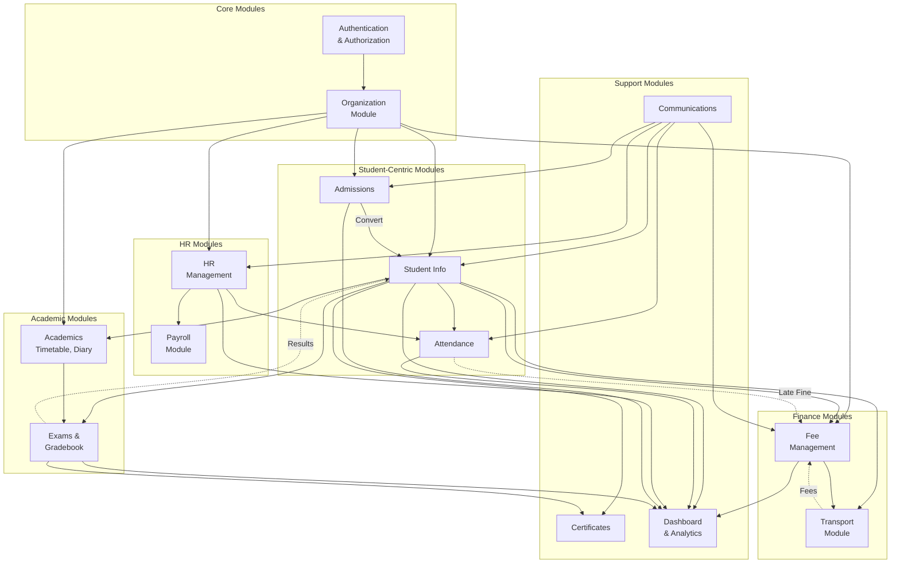

---

## Legend

| Symbol     | Meaning                |
| ---------- | ---------------------- |
| `([text])` | Start/End terminal     |
| `[text]`   | Process/Action         |
| `{text}`   | Decision point         |
| `[(text)]` | Database               |
| `-->`      | Direct flow            |
| `-.->`     | Indirect/Optional flow |
| `subgraph` | Grouped processes      |

---

## How to View These Diagrams

These diagrams are written in **Mermaid** format. You can view them:

1. **GitHub**: GitHub automatically renders Mermaid diagrams in markdown files
2. **VS Code**: Install the "Markdown Preview Mermaid Support" extension
3. **Mermaid Live Editor**: https://mermaid.live
4. **Notion**: Paste code blocks with `mermaid` language
5. **Obsidian**: Native Mermaid support

---

**Document Version**: 1.0
**Created**: December 2024
