# State Machine Diagrams - Campus Verse Web App

This document contains state machine diagrams for key components in the web application.

---

## 1. Authentication Store (authStore)

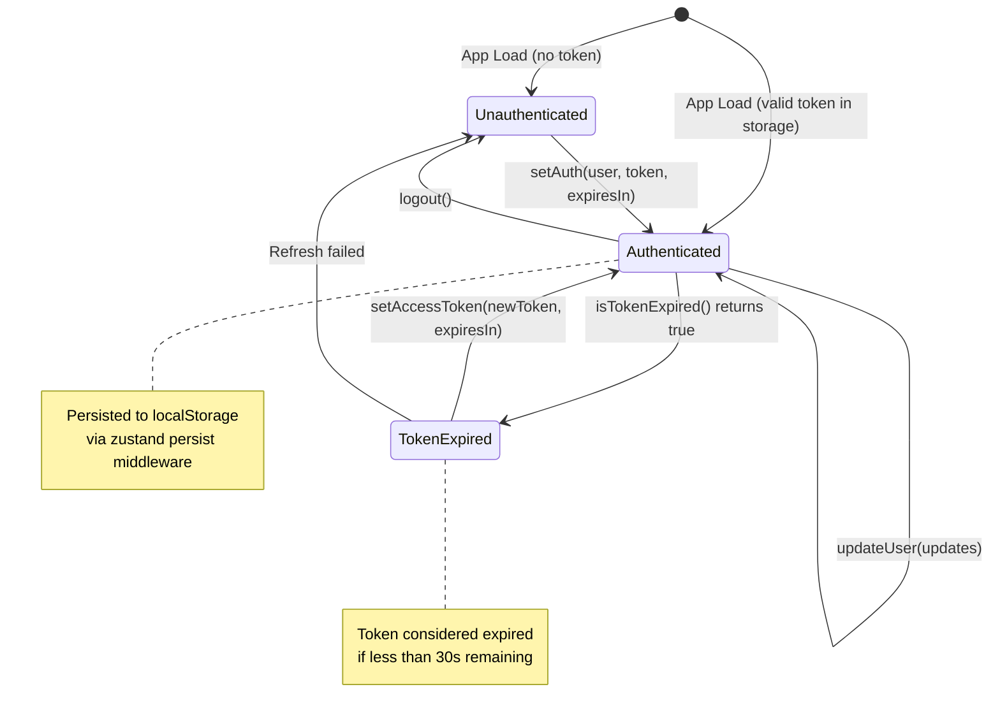

> **Note:** The `Authenticating` state (loading during login) is managed by the LoginPage component, not this store. The store only holds the final authenticated/unauthenticated state.

---

## 2. Branch Store (branchStore)

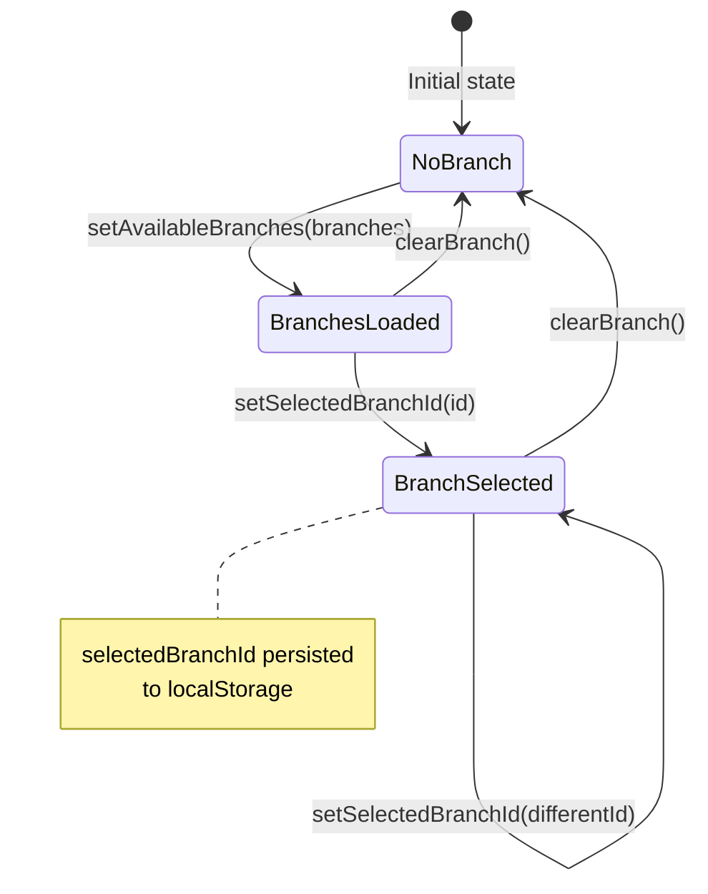

---

## 3. Login Page

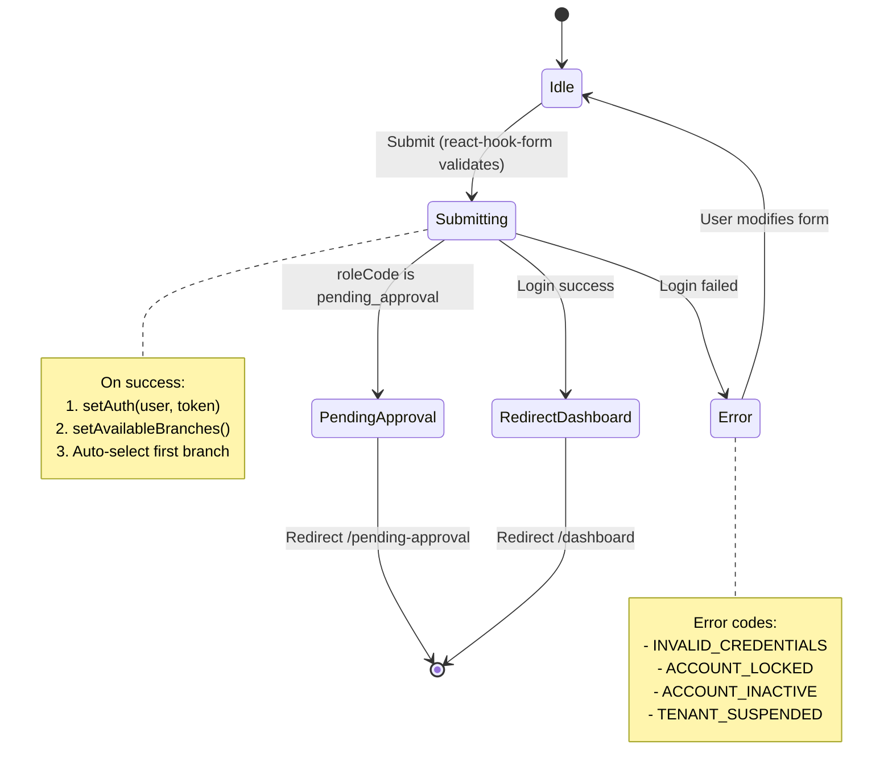

> **Note:** Branch selection is automatic (first branch is selected). There is no manual branch selection step during login.

---

## 4. Signup Page

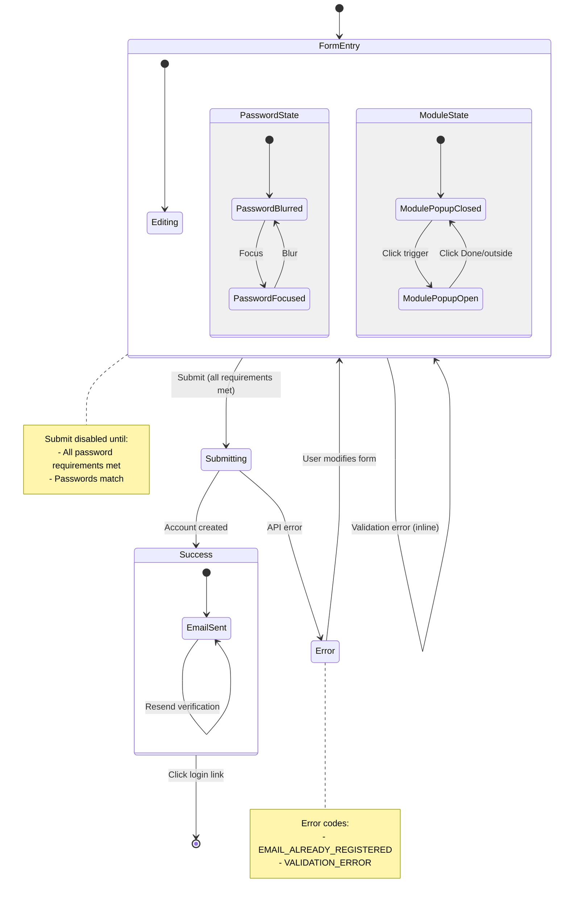

---

## 5. Add Organization Modal (3-Step Wizard)

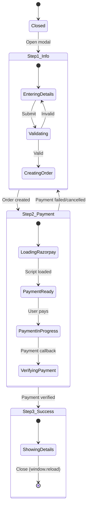

---

## 6. Convert Lead Dialog (Cascading Form)

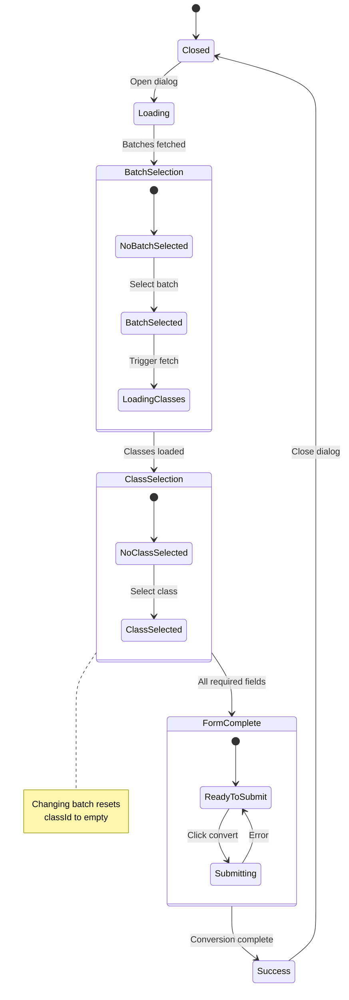

---

## 7. Enroll Application Dialog

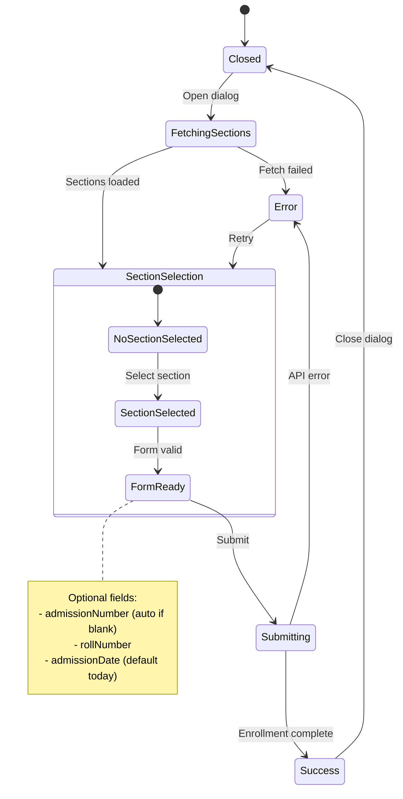

---

## 8. Admissions Page (Multi-View)

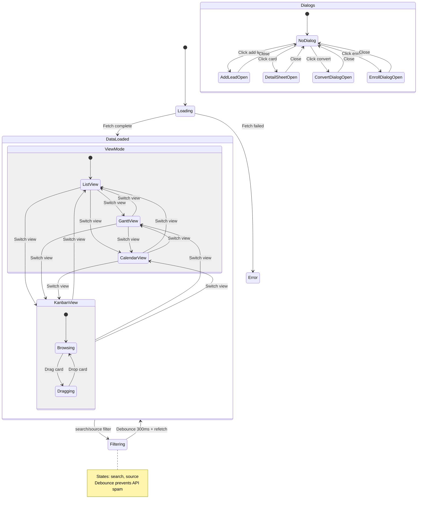

---

## 9. Bulk Upload Page (5-Step Wizard)

```mermaid
stateDiagram-v2
    [*] --> Step1_Select

    state Step1_Select {
        [*] --> NoClassSelected
        NoClassSelected --> ClassSelected: Select class
        ClassSelected --> SectionSelected: Select section
    }

    Step1_Select --> Step2_Upload: Click Continue

    state Step2_Upload {
        [*] --> NoFile
        NoFile --> Dragging: Drag enter
        Dragging --> NoFile: Drag leave
        Dragging --> Step3_Validate: Drop valid file
        NoFile --> Step3_Validate: Browse & select
    }

    state Step3_Validate {
        [*] --> FileReady
        FileReady --> Validating: Click Validate Data
        Validating --> Step4_Process: 2s timeout
    }

    state Step4_Process {
        [*] --> ShowWarnings
        ShowWarnings --> Step2_Upload: Upload Different File
        ShowWarnings --> Importing: Click Start Import
        Importing --> Step5_Complete: 3s timeout
    }

    state Step5_Complete {
        [*] --> ShowingResults
        ShowingResults --> Step1_Select: Upload More
        ShowingResults --> [*]: View Students
    }

    note right of Step4_Process
        Shows validation warnings
        (rows to be skipped)
        Always proceeds regardless
        of error count
    end note
```

---

## 10. Academic Structure Page

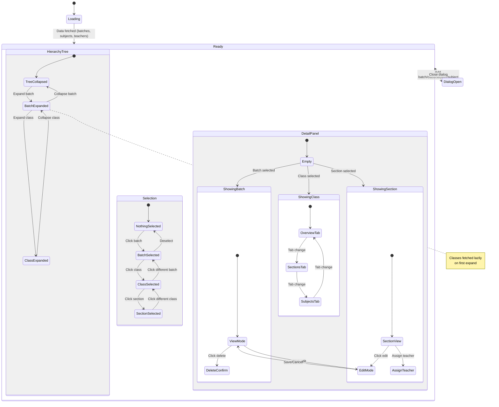

---

## 11. Protected Route (Auth Guard)

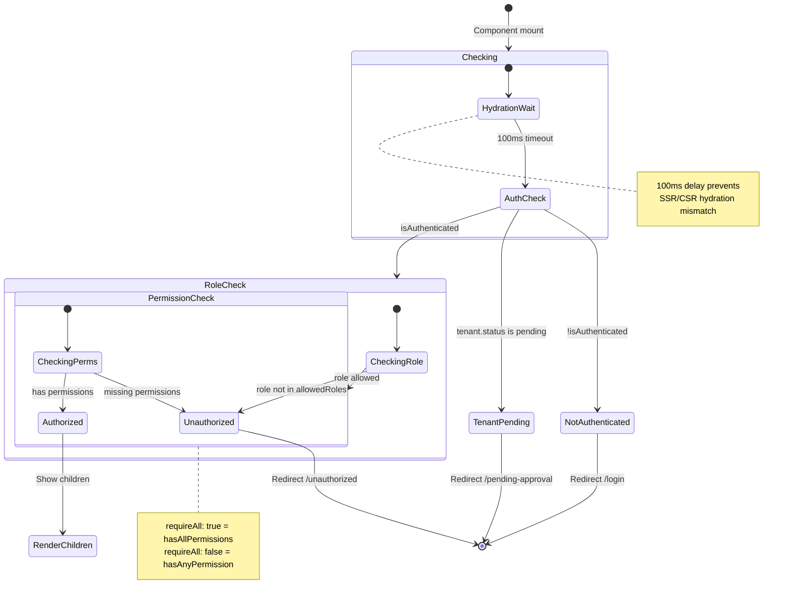

---

## 12. Change Password Modal

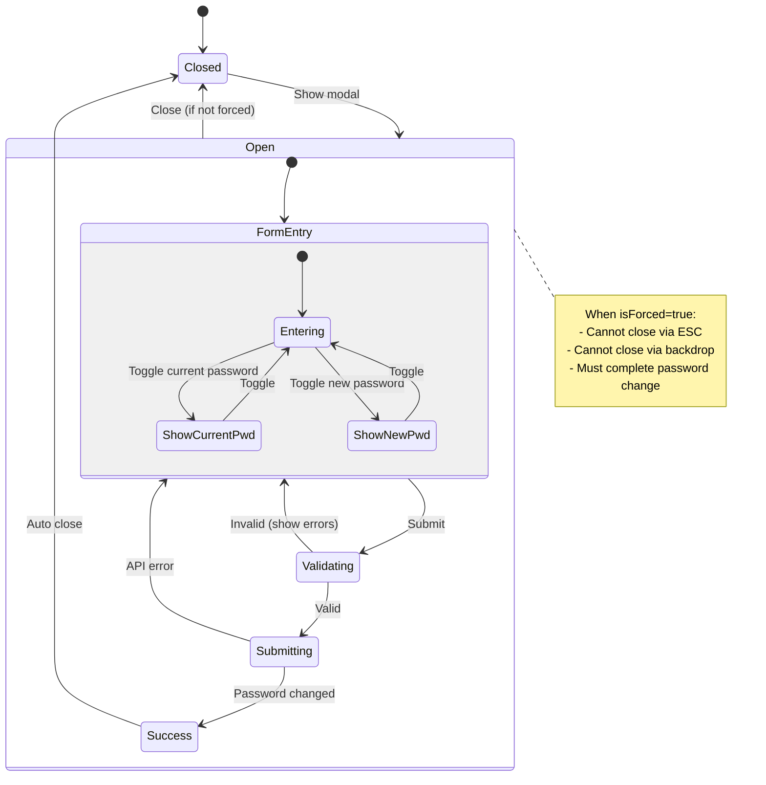

---

## State Management Patterns Summary

| Component          | Pattern                       | Library                      |
| ------------------ | ----------------------------- | ---------------------------- |
| authStore          | Global store with persistence | Zustand                      |
| branchStore        | Global store with persistence | Zustand                      |
| Login/Signup       | Form state + async            | react-hook-form + useState   |
| Dialogs            | Local state + async loading   | useState + useEffect         |
| Multi-step wizards | Step-based state machine      | useState                     |
| Academic Structure | Context + Refs + Events       | React Context + EventEmitter |
| Protected Route    | Auth guard with hydration     | useState + useEffect         |

---

## Rendering These Diagrams

These diagrams use [Mermaid](https://mermaid.js.org/) syntax. To render them:

1. **GitHub/GitLab**: Renders automatically in markdown preview
2. **VS Code**: Install "Markdown Preview Mermaid Support" extension
3. **Online**: Use [Mermaid Live Editor](https://mermaid.live/)
4. **Docusaurus/Storybook**: Enable mermaid plugin
